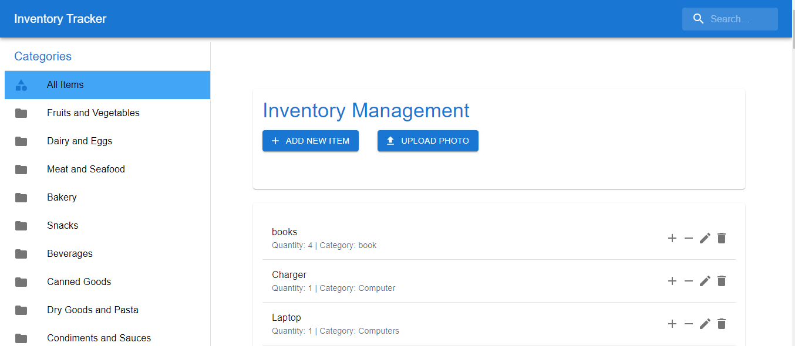

# Inventory Management

An inventory application with item records, categories, quantity controls, and photo-based item entry.



## What it does

- Add, edit, and remove inventory items.
- Adjust item quantities and organize items into categories.
- Upload a photo for item identification and categorization.
- Store inventory data in Firestore.

## Run locally

You need Node.js, npm, a Firebase/Firestore project, and a Google Generative AI API key for the photo-analysis route.

```bash
git clone https://github.com/gelftheshot/inventory-management-app.git
cd inventory-management-app
npm ci
```

Create `.env.local` in the project root:

```dotenv
FIREBASE_API_KEY=your_firebase_web_api_key
GEMINI_API_KEY=your_google_api_key
```

These variable names match the current source. Update the project-specific Firebase web-app settings in `app/firebase.js` for your own Firebase project, and verify that the browser receives the configuration required by the client application. Configure Firestore access for that project.

```bash
npm run dev
```

Open [http://localhost:3000](http://localhost:3000).

For a production build:

```bash
npm run build
npm start
```

The photo-analysis route uses the provider model configured in `app/api/sendphoto/route.js`. Verify provider access and current model availability when setting up your own environment.

## Item entry


## Main files

- `app/page.js`: inventory interface and item interactions.
- `app/firebase.js`: Firebase/Firestore configuration.
- `app/api/sendphoto/route.js`: photo-based item identification and categorization.

[Project write-up](https://www.lihongebre.com/projects/inventory-management)
